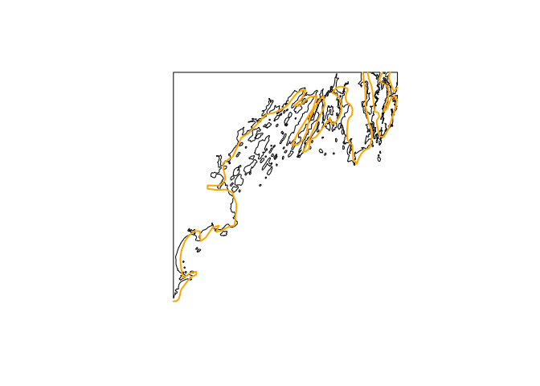

We often use [Natural Earth](https://www.naturalearthdata.com/) to provide free and dependable shoreline respresentations.  It's a great data source and has a great [R package](https://CRAN.R-project.org/package=rnaturalearth) to facilitate its usage. But is has (reasonable) limits in its resolution.  Higher resolution data is available from [GSHHG](https://www.soest.hawaii.edu/pwessel/gshhg/), which we make R-friendly with the [gshhg R package](https://github.com/BigelowLab/gshhg). 

The plot below compares the highest resolution of [Natural Earth](https://www.naturalearthdata.com/) with the highest resolution of [GSHHG](https://www.soest.hawaii.edu/pwessel/gshhg/) for the Casco Bay (Maine) region. 

